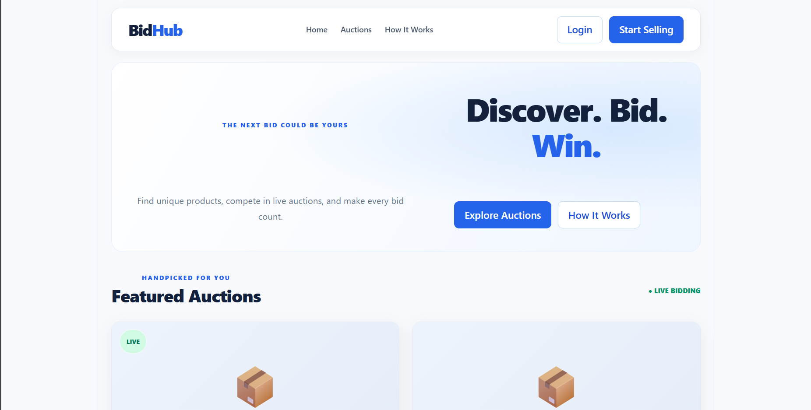
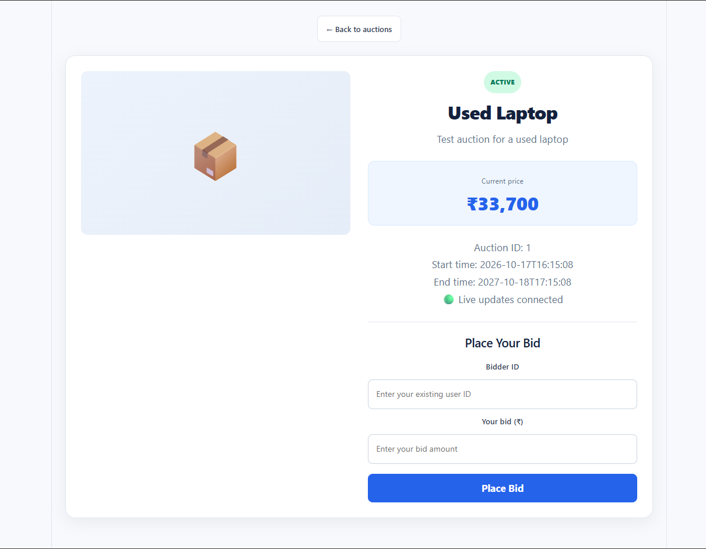
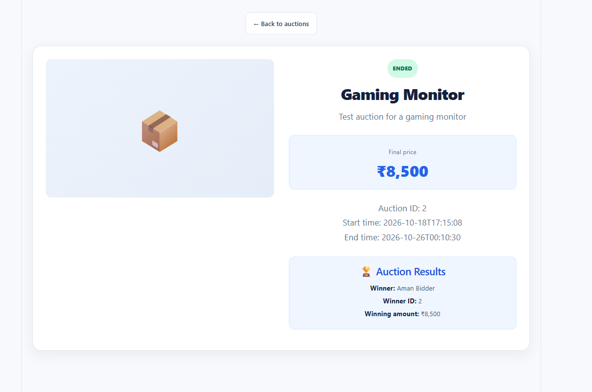

# BidHub — Real-Time Online Auction Platform

BidHub is a web-based auction platform where users can explore listed products, place bids while an auction is active, and see the final result after the auction ends.

The core idea behind BidHub is to make online bidding responsive and fair: bids are validated on the backend, concurrent requests are handled with database locking, and connected clients can receive live bid updates without refreshing the page. When an auction reaches its end time, the backend scheduler closes it and records the highest accepted bidder as the winner.

> **Project status:** Working development version. Before opening it to public users, complete production-readiness work such as authentication and authorization, secrets management, deployment configuration, and security testing.

## Screenshots

Add screenshots of your running application to `docs/screenshots/` using the filenames below. The image links will render automatically once those files are added.

### Homepage



### Active auction and live bidding



### Ended auction and winner results



## Core features

- **Auction browsing:** View available auctions and open an individual auction's details.
- **Live bidding updates:** WebSocket updates let connected clients see bid changes without manually refreshing.
- **Concurrency-safe bidding:** The backend locks the auction row while processing a bid so simultaneous requests cannot both update the same auction price based on stale state.
- **Bid validation:** Reject invalid or non-positive amounts, bids below the configured minimum increment, bids placed before an auction starts, bids after it ends, and bids from the seller on their own auction.
- **Automatic auction closure:** A scheduled backend task checks for expired active auctions and closes them without requiring a user to visit the page.
- **Winner selection:** When an auction ends, the highest accepted bid is used to select the winner. Auctions with no bids end without a winner.
- **Auction results:** Ended auctions display the final price and winner details when a winner exists.
- **Responsive UI:** The React interface is styled for desktop and smaller screens.

## How it works

1. A user opens an auction and sees its current price and status.
2. The user submits a bid through the React frontend.
3. The Spring Boot API validates the bid and obtains a database write lock for the auction.
4. If the bid is valid and higher than the current price by at least the configured increment, the bid is saved and the auction's current price is updated.
5. A bid event is published after the transaction commits; the WebSocket layer broadcasts the update to clients subscribed to that auction.
6. A scheduled task checks for expired auctions. For each eligible auction, it selects the highest bid, records the winner, and changes the status to `ENDED`.
7. The frontend displays the final price and result instead of the bidding form for an ended auction.

## Technology stack

| Layer | Technology | Purpose |
|---|---|---|
| Frontend | React | User interface and interactive auction pages |
| Frontend tooling | Vite | Local development server and frontend build tooling |
| Backend | Java 21 | Application and business logic |
| Backend framework | Spring Boot | REST APIs, dependency injection, scheduling, and application structure |
| Persistence | Spring Data JPA / Hibernate | Mapping Java entities to database records |
| Database | MySQL 8 | Stores users, auctions, and bids |
| Real-time updates | WebSocket with STOMP | Broadcasts bid updates to subscribed clients |
| API testing | Postman | Manual API testing |
| Version control | Git and GitHub | Source control and branch-based development |

## Architecture overview

```text
React + Vite frontend
        |
        | REST API requests
        v
Spring Boot backend --------------------+
        |                               |
        | JPA / Hibernate               | WebSocket / STOMP
        v                               v
     MySQL database                Connected browsers
        ^
        |
Scheduled auction-closing task
```

## Project structure

BidHub contains two main applications: the Spring Boot backend and the React + Vite frontend. The tree below reflects the main files and responsibilities discussed during development; exact package or filename placement may vary slightly in your local repository.

```text
ProjectBidhub/
├── frontend/                         # React + Vite frontend
│   ├── public/                       # Static public assets (if present)
│   ├── src/
│   │   ├── pages/
│   │   │   └── AuctionDetails.jsx    # Auction details, live bidding, and results
│   │   ├── services/
│   │   │   └── websocketService.js   # STOMP/WebSocket connection and subscriptions
│   │   ├── App.jsx                   # Homepage and auction cards
│   │   ├── App.css                   # Shared UI styling
│   │   └── main.jsx                  # React application entry point
│   ├── package.json                  # Frontend dependencies and scripts
│   └── vite.config.js                # Vite configuration (if present)
│
├── src/                              # Spring Boot backend (repository root)
│   ├── main/
│   │   ├── java/
│   │   │   └── com/bidhub/
│   │   │       ├── BidhubApplication.java  # Spring Boot entry point
│   │   │       ├── auction/
│   │   │       │   ├── controller/        # Auction REST endpoints
│   │   │       │   ├── entity/            # Auction entity
│   │   │       │   ├── repository/        # Auction data access and row locking
│   │   │       │   └── service/           # Auction lifecycle and closure logic
│   │   │       ├── bid/
│   │   │       │   ├── controller/        # Bid REST endpoints
│   │   │       │   ├── entity/            # Bid entity
│   │   │       │   ├── repository/        # Bid queries, including highest bid
│   │   │       │   └── service/           # Bid validation and placement
│   │   │       ├── user/
│   │   │       │   ├── entity/            # User entity
│   │   │       │   └── repository/        # User data access
│   │   │       └── ...                    # WebSocket configuration/events,
│   │   │                                  # scheduler, and other classes
│   │   └── resources/
│   │       └── application.properties     # Server and database configuration
│   ├── pom.xml                            # Maven dependencies and build
│   └── mvnw / mvnw.cmd                    # Maven wrapper, if included
│
├── docs/
│   └── screenshots/                  # README screenshots added by the developer
└── README.md
```

### Backend responsibilities

- **Controllers:** expose REST endpoints such as `GET /api/auctions`, `GET /api/auctions/{auctionId}`, and `POST /api/bids`.
- **Entities and repositories:** map users, auctions, and bids to MySQL and retrieve/update persisted records.
- **Services:** apply bidding rules, coordinate concurrency-safe bid placement, and close expired auctions.
- **WebSocket configuration and events:** publish committed bid updates to `/topic/auctions/{auctionId}` through the `/ws` endpoint.
- **Scheduler:** periodically checks for expired auctions and triggers winner selection and auction closure.
- **`application.properties`:** configures the application and database connection. Do not commit real database passwords or other secrets.

> **Before publishing:** compare this illustrative tree with your actual folders in VS Code/File Explorer and adjust any package or filename that differs. The README should document the repository as it exists, not imply that optional files are present.

## Prerequisites

Install the following before running BidHub locally:

- Java 21
- MySQL 8
- Node.js and npm
- Git
- An IDE such as IntelliJ IDEA or Eclipse (optional)
- Postman (optional, for API testing)

## Running locally

### 1. Clone the repository

```bash
git clone https://github.com/Ayush3025/ProjectBidhub.git
cd ProjectBidhub
```

### 2. Configure MySQL

Create a database for BidHub, then configure the backend's datasource URL, username, and password in `application.properties` or through environment variables.

Do not commit real database credentials to GitHub. Use your actual local database name and credentials; the values can vary between environments.

Example configuration (replace the placeholders):

```properties
spring.datasource.url=jdbc:mysql://localhost:3306/YOUR_DATABASE_NAME
spring.datasource.username=${DB_USERNAME}
spring.datasource.password=${DB_PASSWORD}
```

Make sure the database schema and any required test data are prepared before starting the backend.

### 3. Start the backend

From the backend project directory, run the application using your IDE or the project's build tool. For a Maven project with the Maven wrapper:

```bash
./mvnw spring-boot:run
```

On Windows, use `mvnw.cmd spring-boot:run` if the wrapper is present. Otherwise, run the project using the Maven setup already configured on your machine.

The backend is configured locally on port `8080` in the current development setup.

### 4. Start the frontend

Open a second terminal:

```bash
cd frontend
npm install
npm run dev
```

Vite prints the local URL to open in your browser. The port can change if the default port is already in use.

> Ensure the frontend API base URL and WebSocket URL point to the backend address used by your environment.

## Important API flow

The current development API includes these main operations:

- `GET /api/auctions` — retrieve auction listings.
- `GET /api/auctions/{auctionId}` — retrieve one auction and its result details.
- `POST /api/bids` — submit a bid.
- WebSocket STOMP endpoint: `/ws`
- Auction update topic: `/topic/auctions/{auctionId}`

Example bid request:

```json
{
  "auctionId": 1,
  "bidderId": 2,
  "amount": 25000
}
```

The request values are examples only. The auction must be active, within its configured time window, and the bid must meet the current minimum increment. The bidder must not be the seller of that auction.

## Why BidHub?

- **Fairer bid processing:** Database locking protects price updates when requests arrive concurrently.
- **Immediate feedback:** WebSocket messaging reduces the need for manual page refreshes.
- **Reliable auction lifecycle:** Auction closure and winner selection run on the backend, not only in the browser.
- **Clear outcomes:** Ended auctions show the final price and winner when applicable.
- **A practical full-stack project:** Demonstrates frontend development, REST APIs, persistence, scheduled jobs, and real-time communication in one application.

## Current limitations and next steps

BidHub is a working development project, not yet a production-ready commercial auction service. Before public release, consider completing:

- User registration, secure authentication, and server-side authorization.
- Ownership checks for listing creation and management.
- Production secrets and environment configuration.
- Database migrations and backups.
- HTTPS and secure WebSocket configuration.
- Automated unit, integration, and concurrency tests.
- Input validation, rate limiting, logging, monitoring, and error handling.
- Clear rules for refunds, disputes, payments, and prohibited listings if real transactions are introduced.

## Development workflow

The project uses Git branches to separate development from the stable version:

- `develop` — build and test features.
- `main` — stable, release-ready changes.

Test changes on `develop` before merging them into `main`.

## Author

**Ayush Tiwari**

GitHub: [Ayush3025](https://github.com/Ayush3025)

---

Built as a full-stack project exploring real-time online auctions, concurrency-safe bidding, and automated auction settlement.
